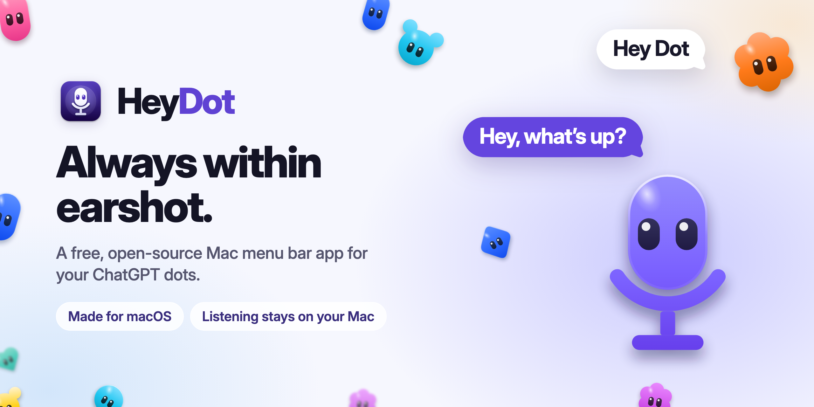
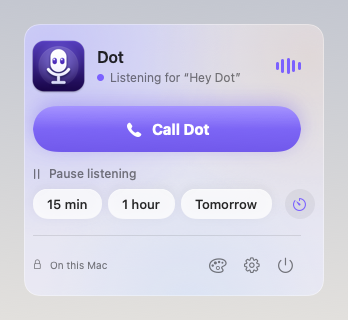
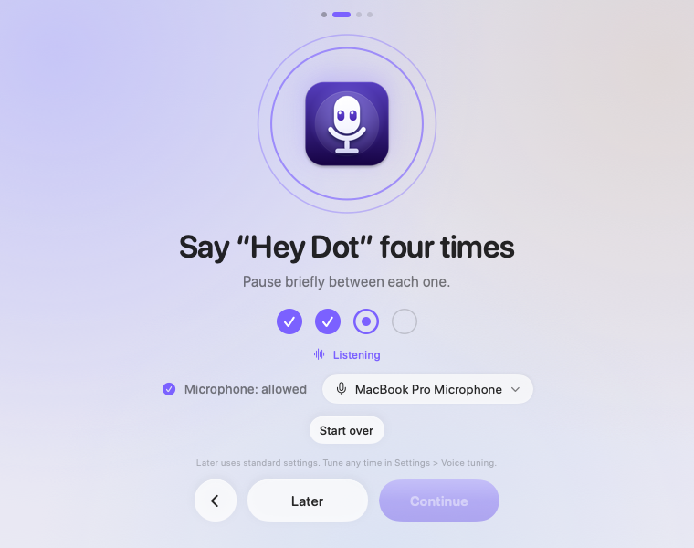

<p align="center">
  <picture>
    <source media="(prefers-color-scheme: dark)" srcset=".github/assets/banner-dark.png">
    
  </picture>
</p>

<p align="center">
  <a href="../../releases/latest"><b>Download for Mac</b></a>
  &nbsp;·&nbsp;
  <a href="#how-it-works">How it works</a>
  &nbsp;·&nbsp;
  <a href="#build-from-source">Build from source</a>
</p>

<p align="center">
  
  
  
</p>

Say **"Hey Dot"** (or "Hey" plus whatever you named your dot) from across the room, and your ChatGPT dot picks up. HeyDot sits in your menu bar, listens for that one phrase on your Mac, and starts the voice call for you. No clicking around, no window hunting.

It's free, open source, and has no account, server or API key of its own.

> Unofficial; not affiliated with OpenAI.

<p align="center">
  <picture>
    <source media="(prefers-color-scheme: dark)" srcset=".github/assets/popover-dark.png">
    
  </picture>
  &nbsp;&nbsp;
  <picture>
    <source media="(prefers-color-scheme: dark)" srcset=".github/assets/tuning-dark.png">
    
  </picture>
</p>

## What you get

- **A wake phrase for your dot.** "Hey Dot" by default, or your dot's own name. A quick voice tuning step learns how you say it.
- **Wake-word listening on your Mac.** The phrase is spotted on device by a small keyword model. That audio is never uploaded.
- **Out of the way.** A menu bar icon, no Dock icon. Pause for 15 minutes, an hour or until tomorrow. The microphone is released while your display sleeps or the Mac is locked.
- **Your mic, not whatever's default.** It uses the built-in microphone unless you pick another, so it won't grab your AirPods mid FaceTime.
- **Your dot, your colours.** Give it a shape, colour and eyes, and the whole app themes itself around it.

## Requirements

- A Mac with Apple silicon, macOS 14 or later (developed and tested on macOS 26).
- A ChatGPT account with access to dots.

## Install

1. Download the HeyDot zip from the [latest release](../../releases/latest), unzip it and drag **HeyDot** to Applications.
2. Open it. HeyDot isn't notarized by Apple yet, so macOS will block it the first time. Go to **System Settings > Privacy & Security**, scroll down, click **Open Anyway** next to HeyDot, and confirm.
3. Follow the setup: name your dot, tune your voice, sign in to ChatGPT. That's it.

**After an update,** macOS may ask once to let HeyDot use **"HeyDot WebCrypto Master Key"** in your keychain. That's the encryption key HeyDot's built-in browser uses to protect what ChatGPT saves on your Mac. "WebCrypto" is the standard name for encryption in web pages; it has nothing to do with cryptocurrency, and HeyDot never reads the key. Enter your Mac password and click **Always Allow**.

Prefer not to run a downloaded build? [Build it yourself](#build-from-source) in a couple of minutes.

## How it works

1. **Listening.** HeyDot captures 16 kHz audio from one chosen microphone and runs it through an on-device [sherpa-onnx](https://github.com/k2-fsa/sherpa-onnx) keyword spotter tuned to your phrase. Nothing is recorded or sent anywhere while it waits.
2. **Waking.** When it hears your phrase, it opens your dot's page in a built-in, hidden ChatGPT web view (signed in once, by you) and presses its call button for you.
3. **Talking.** From there it's a normal ChatGPT voice call: your call audio goes to ChatGPT, just as it does in the ChatGPT app. Hang up or mute from the menu bar.

**What leaves your Mac:** only your normal ChatGPT session (the web view talks to ChatGPT and whichever sign-in provider you use). HeyDot has no servers, no analytics and no telemetry. Details in [SECURITY.md](SECURITY.md).

## Limitations

HeyDot is an early, hobby-sized project. Expect rough edges.

- **It will break sometimes.** HeyDot presses buttons on ChatGPT's own web page, and that page changes without notice (the call button moved in November 2026). When that happens, calls stop working until HeyDot is updated. Watch this repo for releases, and please [open an issue](../../issues) if calls stop.
- **If something's off,** click **Not working?** in the menu bar popover. It checks your microphone, listening, your wake phrase, your ChatGPT sign-in and the call button, one at a time, and offers the fix for whatever fails.
- **Not notarized.** macOS warns you the first time you open it (see [Install](#install)), and may ask about the keychain after each update. A notarized build may come if there's interest.
- **Your ChatGPT sign-in can expire.** HeyDot keeps it fresh, but if ChatGPT signs you out, use **Open ChatGPT** in the popover to sign in again.
- Short, distinct names work best. Very long or unusual names are harder to spot reliably, and sound-alikes can occasionally trigger it. Voice tuning helps.
- English wake phrases only, for now.
- Apple silicon only.

## Build from source

You need Xcode (Swift 6) on an Apple silicon Mac.

```sh
git clone <this repo> && cd heydot
Scripts/fetch-vendor.sh        # pinned sherpa-onnx and keyword model, checksum verified
swift test --no-parallel
HEYDOT_APPROVED_CERT_SHA1=<your signing identity SHA-1> ./build-app.sh release
```

Any code-signing identity from `security find-identity -v -p codesigning` works, including the free Apple Development certificate Xcode creates when you sign in with an Apple ID. More in [CONTRIBUTING.md](CONTRIBUTING.md) and [docs/DEVELOPMENT.md](docs/DEVELOPMENT.md).

## Uninstall

Quit HeyDot, then:

```sh
/Applications/HeyDot.app/Contents/MacOS/HeyDot --uninstall-data   # settings, sign-in, logs, login item
rm -rf /Applications/HeyDot.app
```

## License

[Apache-2.0](LICENSE). Third-party components and their licenses are listed in [THIRD_PARTY_NOTICES.md](THIRD_PARTY_NOTICES.md).

HeyDot is an independent project. ChatGPT is a trademark of OpenAI; HeyDot is not affiliated with or endorsed by OpenAI.
